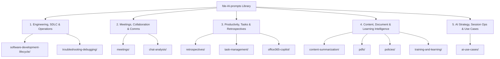

# Prompt & Use-Case Engineering Standards

This document defines the architecture, taxonomy, classification tiers, and formatting standards for the **AI Prompts & Use Cases** library.

## 1. Design Principles

1. **Discoverability First:** Every folder belongs to a clear functional domain and contains an index (`README.md` / `readme.md`) explaining *which* prompt to pick and *when*.
2. **Preserve Context & Lineage:** Prompt iterations across different models (Gemini, Claude, GPT-4o / Azure AI Foundry, AWS Bedrock, Microsoft 365 Copilot) capture valuable engineering nuances. Categorize and group variants by tier rather than deleting historical context.
3. **Copy-Paste Ergonomics:** Prompts must live inside fenced ```` ```text ```` blocks (wrapped in collapsible `<details>` sections for scannability) so GitHub renders a one-click **Copy** button.
4. **Small-Batch Evolution (DevOps Mindset):** Add or refine prompts in small, self-contained changes accompanied by catalog/index updates.

---

## 2. Repository Taxonomy (5 Functional Domains)

All directories map into five logical domains:



| Domain | Directories | Scope |
| :--- | :--- | :--- |
| **1. Engineering, SDLC & Operations** | [`software-development-lifecycle/`](./software-development-lifecycle/), [`troubleshooting-debugging/`](./troubleshooting-debugging/) | Git commits, PR summaries, CI/CD pipeline log analysis, service migration audits, and diagnostics. |
| **2. Meetings, Collaboration & Communications** | [`meetings/`](./meetings/), [`chat-analysis/`](./chat-analysis/) | MS Teams & general meeting minutes, auditable decision/action extraction, tone analysis, and project chat Q&A. |
| **3. Productivity, Task Management & Retrospectives** | [`retrospectives/`](./retrospectives/), [`task-management/`](./task-management/), [`office365-copilot/`](./office365-copilot/) | Daily/weekly/monthly worklog reflection, productivity frameworks, email-to-task extraction, and M365 Copilot workflows. |
| **4. Content, Document & Learning Intelligence** | [`content-summarization/`](./content-summarization/), [`pdfs/`](./pdfs/), [`policies/`](./policies/), [`training-and-learning/`](./training-and-learning/) | Summarizing articles, video scripts, Confluence PDFs, privacy policies, and technical training transcripts. |
| **5. AI Strategy, Session Ops & Use Cases** | [`ai-use-cases/`](./ai-use-cases/) | High-level multimodal/GenAI use-case blueprints and AI chat session audit / context hand-off prompts. |

---

## 3. Prompt Classification Tiers

To simplify selection when multiple prompts address a similar topic, every prompt is classified into one of three tiers:

| Tier | Badge | Characteristics | Best Used When |
| :--- | :--- | :--- | :--- |
| **Tier 1** | `🟢 Quick` | 3–25 lines, minimal boilerplate, direct instruction. | Fast ad-hoc chat turns where speed matters more than strict schema enforcement. |
| **Tier 2** | `🔵 Structured` | Explicit **Role/Persona**, step-by-step instructions, and defined Markdown/table output sections. | Repeatable daily workflows (PRs, retro analysis, training summaries, prioritized action tables). |
| **Tier 3** | `🟣 System` | Production-grade system prompt with strict guardrails (zero hallucination, timestamp citations, confidence scoring, sparse-input fallbacks, self-check). | Auditable client records, automated agents, custom GPTs/Gems, or high-stakes documentation. |

---

## 4. Standard File Structure

### 4.1 Prompt Files
Every prompt file should use `kebab-case` naming (`<verb>-<target>[-<qualifier>].md`) and start with an `# H1` title followed by a standardized **Metadata Header**:

```markdown
# Descriptive Prompt Title

> **Domain:** [1–5 Domain Name] | **Category:** `folder-name` | **Tier:** 🟢 Quick / 🔵 Structured / 🟣 System  
> **Use When:** [1-sentence decision rule explaining when to pick this prompt]  
> **Input:** [Expected input, e.g., `git diff`, MS Teams `.vtt`/`.docx` transcript, PDF] | **Output:** [Deliverable format]  
> **Target / Tested With:** [Model-agnostic, or specific platform e.g., M365 Copilot, Claude, Gemini, GPT-4o]

<details>
<summary>📝 Prompt Title (Click to expand)</summary>

```text
[Copy-pasteable prompt content]
```

</details>
```

> [!TIP]
> Starter templates are ready to copy in [`templates/prompt-template.md`](./templates/prompt-template.md) and [`templates/use-case-template.md`](./templates/use-case-template.md).

### 4.2 Category Index (`README.md` / `readme.md`)
Every directory must include an index file containing:
1. **Scope & Purpose** of the category.
2. **Quick-Pick Decision Table** comparing all prompts in the directory (File, Tier, Primary Focus, Input → Output).
3. **Related Categories** cross-linking overlapping capabilities in other folders.

---

## 5. Quality & Safety Guardrails

When authoring or upgrading prompts to `🔵 Structured` or `🟣 System`:
- **Source Grounding (Zero Hallucination):** Instruct the model to rely strictly on provided inputs and never fabricate names, dates, metrics, or commit details.
- **Inference & Source Labeling:** Distinguish explicit facts from inferred items using tags such as `[Explicit]`, `[Implicit]`, and `(Inferred, Confidence: High/Medium/Low)`.
- **Data Privacy & Secret Hygiene:** Never hardcode credentials, tokens, customer PII, or internal URLs in stored prompts. Exclude sensitive config files (e.g., `EnvironmentVariables.xml`, `.env`) when generating diffs.

---

## 6. Small-Batch Contribution Checklist

1. Pick the appropriate directory from the [5 Functional Domains](#2-repository-taxonomy-5-functional-domains) (or propose a new folder only if none fit).
2. Copy [`templates/prompt-template.md`](./templates/prompt-template.md) (or [`templates/use-case-template.md`](./templates/use-case-template.md)).
3. Assign the appropriate **Tier** (`🟢 Quick`, `🔵 Structured`, or `🟣 System`) and verify the prompt is inside a fenced ```` ```text ```` block.
4. Add a row to the folder's `README.md` decision table and [`CATALOG.md`](./CATALOG.md).
